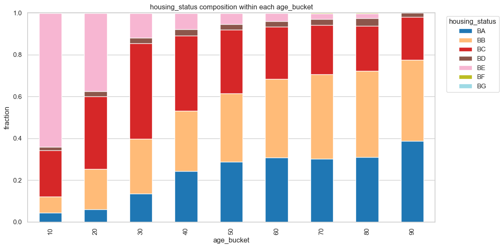

# 💳 CUAI Datathon: Imbalanced Fraud Detection Ensemble & Curriculum Pipeline

[](https://www.python.org/)
[]()
[-success)]()

> **CUAI (중앙대학교 인공지능 학회) 데이터톤 프로젝트**  
> **극심한 클래스 불균형(Imbalanced Binary Classification) 사기 탐지(Fraud Detection) 문제를 위한 CorrStack 파생 변수 엔지니어링, 네거티브 커리큘럼 러닝, GBDT 3종 동일 전처리 앙상블 파이프라인**

---

## 📌 프로젝트 개요 (Overview)

금융·결제 사기 탐지 데이터셋과 같이 양성(Fraud) 비율이 극도로 낮은 불균형 데이터셋에서는 단순 정확도나 ROC-AUC 대신 **PR-AUC (`average_precision_score`, AP)** 최적화가 핵심입니다.

본 프로젝트는 **동일한 Stratified 5-Fold 검증 스플릿**과 **정보 누수(Data Leakage)를 차단한 전처리 파이프라인**을 구축하고, 다변량 상관관계 기반 파생 피처(`CorrStack`), 네거티브 샘플 난이도 조절 커리큘럼 러닝(`Negative Label Curriculum`), 그리고 **CatBoost + XGBoost + LightGBM** 앙상블을 결합하여 단일 베이스라인 대비 OOF PR-AUC를 큰 폭으로 향상시켰습니다.

<p align="center">
  
</p>

---

## 🛠️ 핵심 파이프라인 및 기술적 특징 (Key Methodology)

1. **심층 EDA 및 다변량 피처 엔지니어링 (`src/feature_eda_corrstack.py`, `notebooks/correlation_deep_eda.ipynb`, `pca_multivariate_eda.ipynb`)**
   - 수치형·범주형 변수의 결측 패턴 및 타깃 조건부 분포 분석.
   - 상위 상호작용 변수 쌍(Pairwise Lift & Correlation Stack)을 추출하여 비선형 결정 경계를 보강하는 `CorrStack` 피처셋 생성.

2. **Stratified 5-Fold 기반 모델 비교 및 Optuna TPE 튜닝 (`src/catboost_fixed_validation_suite.py`, `docs/모델_시도_및_CatBoost_선정.md`)**
   - 동일 전처리 행렬에서 선형 모델(`Linear SGD`: OOF AP `0.1078`) 대비 트리 부스팅 계열(`LightGBM`: `0.1584`, `XGBoost`: `0.1626`, `HistGradientBoosting`: `0.1628`)의 우위를 확인.
   - **CatBoost** 의 Ordered Boosting 및 대칭 트리(Oblivious Trees) 구조가 불균형 데이터 과적합 억제에 가장 효과적임을 확인하고 Optuna TPE 튜닝으로 단일 모델 OOF AP **`0.1756 ~ 0.1805`** 달성.

3. **네거티브 라벨 커리큘럼 러닝 (`src/netgative_label_curriculum_catboost.py`)**
   - 다수 클래스(정상 거래) 내 쉬운 샘플과 경계선(Hard Negative) 샘플의 학습 가중치를 단계적으로 조정하여 정밀도-재현율 트레이드오프 개선.

4. **동일 전처리 멀티 부스팅 앙상블 (`notebooks/best_final.ipynb`, `fraud_ensemble_same_preprocess.ipynb`)**
   - CatBoost, XGBoost, LightGBM의 Out-of-Fold 예측 확률을 랭크/가중 블렌딩하여 일반화 성능 극대화.

---

## 📁 폴더 구조 (Repository Structure)

```text
cuai-datathon-fraud-detection/
├── src/
│   ├── feature_eda_corrstack.py                 # 상관관계 및 Pairwise Lift 기반 CorrStack 파생 변수 생성기
│   ├── catboost_fixed_validation_suite.py       # Stratified 5-Fold 고정 검증 및 하이퍼파라미터 평가 스위트
│   ├── netgative_label_curriculum_catboost.py   # 불균형 극복을 위한 Negative Label Curriculum Learning 구현
│   ├── run_experiment_grid.py                   # 전처리·모델 조합 자동 그리드 실험 러너
│   ├── export_baseline_experiment_excel.py      # 실험 로그 및 성능 비교 리포트 추출기
│   └── solution_3.py                            # 엔드투엔드 학습 및 추론 파이프라인 스크립트
├── notebooks/
│   ├── best_final.ipynb                         # 최종 제출 앙상블 모델 파이프라인
│   ├── fraud_ensemble_same_preprocess.ipynb     # 동일 전처리 기반 CatBoost + XGB + LGBM 5-Fold 앙상블
│   ├── fraud_catboost_guided_pipeline.ipynb     # CatBoost 집중 튜닝 파이프라인
│   ├── fraud_lgbm_guided_pipeline.ipynb         # LightGBM 집중 튜닝 파이프라인
│   ├── netgative_label_curriculum_catboost.ipynb# 네거티브 커리큘럼 러닝 실험 노트북
│   ├── eda_visualization.ipynb                  # 변수 분포 및 타깃 관계 시각화
│   ├── correlation_deep_eda.ipynb               # 다변량 상관관계 심층 분석
│   └── pca_multivariate_eda.ipynb               # PCA 차원 축소 및 이상치 구조 분석
├── docs/
│   ├── 모델_시도_및_CatBoost_선정.md             # 모델별 OOF PR-AUC 비교 분석 및 선정 근거 문서
│   ├── 전처리_가이드.md                          # 결측치·인코딩·스케일링 전처리 설계 문서
│   └── 전처리_가이드_요약표.md                    # 변수별 전처리 규칙 요약표
├── results/                                     # 실험 그리드 결과 CSV 및 최종 앙상블 메타/리포트 JSON
├── figures/                                     # 피처 중요도 및 EDA 시각화 이미지
└── requirements.txt
```

---

## 🚀 실행 방법 (Usage)

```bash
git clone https://github.com/e2dus/cuai-datathon-fraud-detection.git
cd cuai-datathon-fraud-detection
pip install -r requirements.txt

# CorrStack 파생 피처 생성 및 고정 5-Fold 검증 실행
python src/feature_eda_corrstack.py
python src/catboost_fixed_validation_suite.py
```

---

## 👤 Author

- **정의연 (Ui-Yeon Jeong)** — 중앙대학교 AI학과 / CUAI (`e2dus`)
